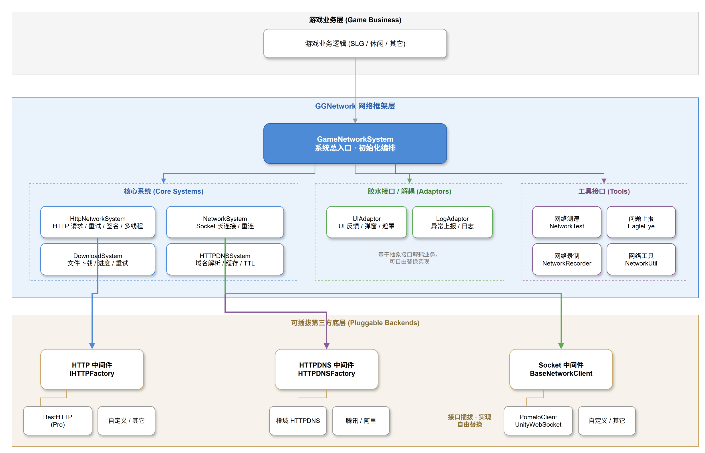
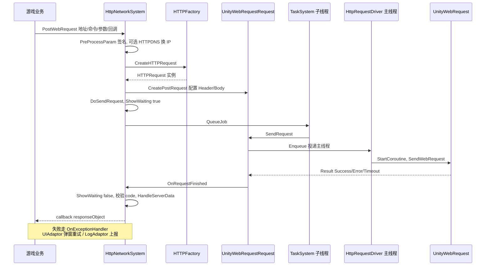
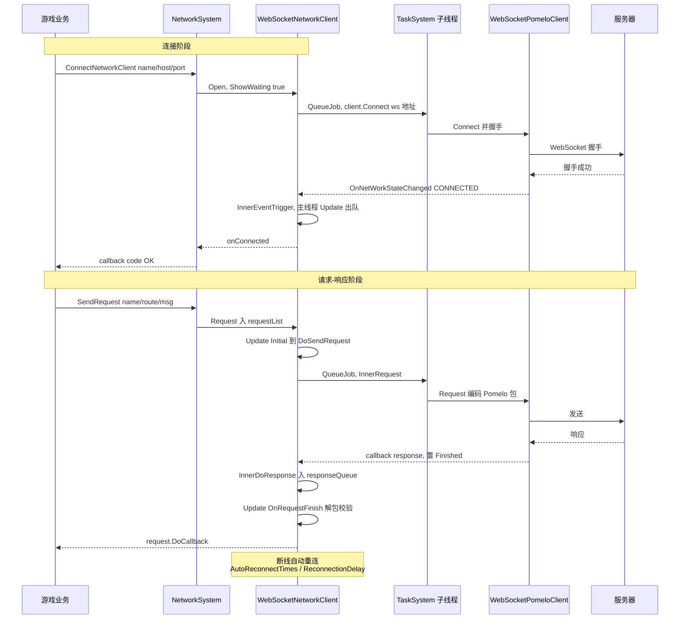
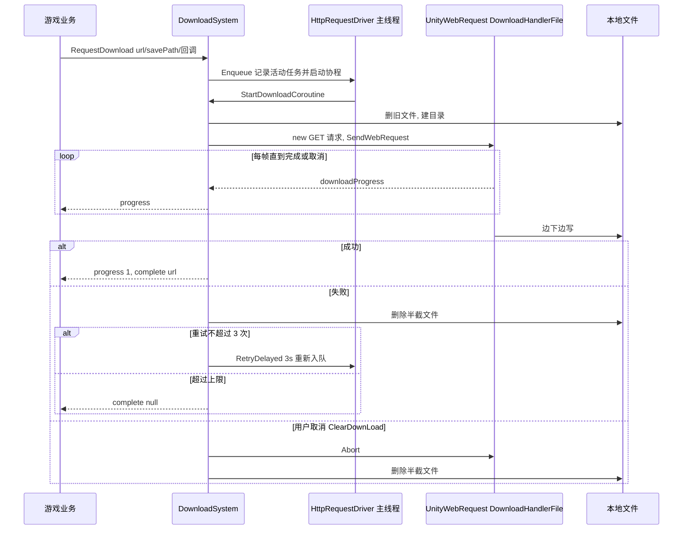

# GGNetwork (内测版)

面向 Unity 游戏客户端的可插拔网络框架，支持 HTTP、WebSocket / Pomelo、HttpDNS、下载、异常重试与断线重连。

[](https://github.com/gonglei007/GGFramework-GGNetwork/blob/main/GGNetwork/ProjectSettings/ProjectVersion.txt) [](https://github.com/gonglei007/GGFramework-Core/tree/v0.1.1) [](https://github.com/gonglei007/GGFramework-GGNetwork/tree/main)

## 项目导航

[Demo 体验](https://github.com/gonglei007/GGFramework-Demo) · [架构文档](https://github.com/gonglei007/GGFramework-Docs) · [Core](https://github.com/gonglei007/GGFramework-Core) · [GGResource](https://github.com/gonglei007/GGFramework-GGResource) · **GGNetwork** · [GGUI](https://github.com/gonglei007/GGFramework-GGUI) · [GGUser](https://github.com/gonglei007/GGFramework-GGUser)

> **先体验整体框架**：[打开独立 Demo](https://github.com/gonglei007/GGFramework-Demo#快速开始)，体验资源、HTTP、UI、用户 SDK 与 Lua 的集成流程。[操作指南](https://github.com/gonglei007/GGFramework-Demo/blob/main/documents/showcase-guide.md) · [验收记录](https://github.com/gonglei007/GGFramework-Demo/blob/main/documents/showcase-verification.md)。

## 模块关系

本工程通过 UPM 固定使用 **Core v0.1.1**。HTTP / 长连接底层可替换，UI 和日志由 `UIAdaptor` / `LogAdaptor` 委托接入；宿主可组合 GGUI 或自己的界面系统。Demo 中的旧网络集成副本与本模块当前 API / 默认后端分别维护。

完整依赖图、工程锁定版本和源码副本边界由[架构文档中心](https://github.com/gonglei007/GGFramework-Docs#模块关系)统一维护。

## 快速开始

在准备存放代码的目录运行：

```powershell
git clone https://github.com/gonglei007/GGFramework-GGNetwork.git
# 在 Unity Hub 中打开 GGFramework-GGNetwork/GGNetwork
```

1. 用 Unity **6000.3.13f1** 打开 `GGNetwork` 工程，等待 Core 和 Unity 包解析完成。
2. 查看模块场景 [Demo.unity](GGNetwork/Assets/Demo/Demo.unity) 与[演示脚本](GGNetwork/Assets/Demo/Scripts/Demo.cs)。联机前将 HTTP、Pomelo 地址 / 端口和 HttpDNS 配置替换为自己的测试服务。
3. 按场景按钮观察请求、异常反馈和重连；希望先跑通本机回环 HTTP，可直接使用上方的独立 Demo。
4. 接入现有工程时，复制框架与依赖目录，并按[快速接入指南](documents/quickstart.md)完成初始化和宿主回调绑定。

### 实际 Unity 验证

2026-11-20 在 Windows 11 / Unity 6000.3.13f1 实跑默认工程：EditMode **162 通过、0 失败、0 跳过**，退出码 0（含 2 项可选依赖回归）。[环境、时间、原始 XML 摘要及逐项结果](documents/unity-verification-2026-11-20.json)。首次原始检出因缺失 BestHTTP 无法编译，修复后重跑通过；这不是第三方后端或真实业务服务的联调结论。

### 可选 BestHTTP 依赖

默认检出只使用 UnityWebRequest，不需要 BestHTTP。安装兼容的 BestHTTP 插件并确保 `GGFramework.GGNetwork` 程序集能引用它后，才可添加 `GGNETWORK_BESTHTTP` 脚本宏并选择旧 BestHTTP 后端；EagleEye 也依赖该开关。未安装时显式选择 BestHTTP 会抛出 `NotSupportedException`，不会静默切换后端。本次 Unity 验证覆盖默认后端编译与模块测试，未验收第三方 BestHTTP 版本兼容性和真实 EagleEye 服务。

### 最小接入代码

复制框架与依赖目录到你的工程，并在 `Packages/manifest.json` 添加 **GGFramework.Core** 依赖（`#v0.1.1`，基础类单一源）。将代码保存为 `NetworkHello.cs` 并挂到场景对象，把示例 URL 与参数替换为自己的测试服务：

```csharp
using UnityEngine;
using SimpleJson;
using GGFramework.GGNetwork;

public sealed class NetworkHello : MonoBehaviour
{
    private void Start()
    {
        GameNetworkSystem.Instance.Init();
        // Init() 会设置默认配置；自定义参数在其后写入。
        NetworkConst.InitEx(secretKey: "your-key", deviceUID: SystemInfo.deviceUniqueIdentifier,
            channel: "dev", clientVersion: Application.version);

        var param = new JsonObject();
        param["username"] = "player1";
        HttpNetworkSystem.Instance.PostWebRequest("http://api.example.com", "/user/login",
            param, HttpNetworkSystem.ExceptionAction.ConfirmRetry,
            response => Debug.Log(response.ToString()));
    }
}
```

> 完整接入流程见 [如何快速接入?](documents/quickstart.md) 与 [技术手册](documents/manual.md)


## 简介

> 它不是一个网络功能的底层实现，它封装了游戏客户端所需的一些网络特性，让游戏网络的稳定性和体验感更好。并且可以很方便地挂载第三方或者自定义的网络底层模块。

框架面向不同业务层级的功能划分：

* **游戏业务层** — 交给游戏业务开发环节处理
* **游戏网络层** — 框架提供异常检查与处理
* **网络通信层** — 框架提供异常检查与处理

### 目标

为游戏客户端提供：

* 更好的网络稳定性
* 更好的网络交互体验

## 功能与特性

**网络交互体验**

- 支持 UI 反馈回调挂载，接入简单，当网络连接、请求发生异常或等待时，获得更好的交互体验
- 支持多线程请求，避免网络卡顿对 UI 产生影响
- 支持请求异常响应，例如失败后自动重试、手动重试、忽略等
- 支持断线重连，包括自动重连、手动重连

**网络质量保障**

- 支持 HttpDNS，避免玩家端的 DNS 劫持
- 支持网络异常上报，让开发者了解分布各地的玩家的网络状况

**第三方支持**

- 支持 **HTTP/HTTPS 连接**（已实现）：默认使用 **Unity 原生 `UnityWebRequest`** 作为 HTTP 底层（内部实现，具备超时/Header 注入/状态映射/异常上报，`HttpNetworkSystem.UseUnityWebRequest` 可回退）；也可挂载自定义或其它第三方 HTTP 模块
- 支持 **Socket / 长连接**（已实现）：**内置**基于 WebSocket + Pomelo 协议的客户端（`GGFramework.GGNetwork.Socket.WebSocket`，传输层用 `ClientWebSocket`，应用层内化握手/心跳/请求-响应/推送路由）；可通过 `BaseNetworkClient` 挂载其它第三方长连接模块，并保留 TCP 版 `PomeloClient` 作为可切换回退（`NetworkSystem.UseWebSocket=false`）
- 支持 **HttpDNS Provider 插拔**：预置橙域实现，工厂预留腾讯、阿里

> **可插拔设计**：框架通过 `IHTTPFactory`（HTTP 底层）、`BaseNetworkClient`（长连接底层）、`UIAdaptor`/`LogAdaptor`（UI 与上报解耦）、`HTTPDNSFactory`（域名解析）等抽象接口，将各类底层实现与业务解耦，可自由替换或挂载第三方实现。

## 工程内容

<table>
    <tr><th>目录</th><th>内容</th><th>说明</th></tr>
    <tr>
        <td>GGNetwork/Assets/Scripts/GGNetwork</td>
        <td>框架代码</td>
        <td>可以直接复制到目标工程中使用。</td>
    </tr>
    <tr>
        <td>GGNetwork/Assets/Demo</td>
        <td>演示工程</td>
        <td>可以作为框架使用的参考。</td>
    </tr>
</table>

## 核心模块

| 模块 | 说明 |
| ---- | ---- |
| `GameNetworkSystem` | 系统总入口，按固定顺序完成整体初始化编排 |
| `HttpNetworkSystem` | HTTP 层总入口：`Post/Get` 请求、异常处理策略、参数签名、多线程、结果统一分发 |
| `NetworkSystem` | 长连接总入口：客户端连接管理（默认 game / notify 两条）、请求发送、轮询刷新 |
| `DownloadSystem` | 文件下载管理：Unity 原生 `DownloadHandlerFile` 边下边写、进度/总大小回调、失败自动重试 |
| `HTTPDNSSystem` | 域名解析：本地缓存、TTL 定时刷新、按 IP 替换 host |
| `ServiceCenter` | 网络服务中心：连接/请求超时参数、服务域名动态刷新 |

## 架构



### 关键流程时序图

以下三张时序图按源码核实绘制，涵盖框架三条核心链路：HTTP 请求（多线程 + 主线程调度）、WebSocket 长连接与请求-响应、文件下载（边下边写 + 失败重试）。图以 **mermaid** 内嵌维护（GitHub 原生渲染），格式约定见 GGFramework-Docs `architecture/architecture-diagram.md` §5。

#### HTTP 请求

`HttpNetworkSystem` 在子线程（`TaskSystem`）发起，但 `UnityWebRequest` 必须主线程创建与发送，因此经 `HttpRequestDriver` 把发送协程投递回主线程，完成后统一由 `OnRequestFinished` 分发成功/错误/超时。



#### WebSocket 长连接与请求

`NetworkSystem` 管理多条 `BaseNetworkClient`（默认 `game` / `notify`）。连接与请求均在子线程发起，事件经内部队列在主线程 `Update` 出队回调；断线时按 `AutoReconnectTimes` / `ReconnectionDelay` 自动重连。



#### 文件下载

`DownloadSystem` 基于 `UnityWebRequest` + `DownloadHandlerFile` 边下边写本地文件（不占内存），同样经 `HttpRequestDriver` 投递主线程启动协程；失败删半截文件并延迟 3 秒重试（最多 3 次），`ClearDownLoad` 可取消。



## 文档

* [如何快速接入?](documents/quickstart.md)
* [技术手册](documents/manual.md)
* 参考文档(TODO)

## 交流反馈

使用过程中遇到问题、有改进建议，或是想聊聊游戏客户端网络方面的经验，欢迎加入我们：

| 渠道 | 说明 |
| ---- | ---- |
| **QQ 群** `242500383` | [](https://qm.qq.com/cgi-bin/qm/qr?k=fy4Z65nE-5Jd1ay8FkJpDc9iPJyW3d38&jump_from=webapi) 点击加入游戏研发与技术交流群，群内可即时反馈问题 |
| **GitHub Issues** | 提交 bug / 功能建议，点右上角 [New Issue](https://github.com/gonglei007/GGFramework-GGNetwork/issues) |

> 内测期间，你的每一个反馈都在帮助框架变得更好。

## 依赖

| 依赖 | 性质 | 说明 / 获取方式 |
| ---- | ---- | ---- |
| **Unity Web Request** | 内置（默认） | HTTP 底层**默认内置** Unity 原生实现（传输层用 `UnityEngine.Networking.UnityWebRequest`，见 `Scripts/GGNetwork/HTTP`），不依赖第三方 HTTP 库 |
| **Best HTTP (Pro)** | 可选（第三方适配） | 原 HTTP 底层，已迁移；如需回退可选购导入后经 `HttpNetworkSystem.UseUnityWebRequest=false` 启用，见下方"获取 Best HTTP (Pro)" |
| **PomeloClient / UnityWebSocket** | 内置（回退） | 长连接**默认已内置内部 WebSocket 实现**（`Scripts/GGNetwork/Socket/WebSocket`）；外部 TCP 版 `PomeloClient` 仅作可选回退底层（`Assets/LocalPackages`，`NetworkSystem.UseWebSocket=false` 时启用） |
| **GGFramework.Core** | UPM（必需） | `Singleton` / `CoroutineUtil` / `TaskSystem`（`GTask`）的单一源，经 UPM git URL 引用 `#v0.1.1`；工程内本地副本已删除 |
| **Dependency/Utils** | 内置 | `GameDebugger` / `ZipUtil` 等通用工具（`Singleton` / `CoroutineUtil` / `TaskSystem` 已移至 GGFramework.Core） |

### 获取 Best HTTP (Pro)

Best HTTP (Pro) 是付费商业插件，出于许可协议考虑**不随仓库分发**。使用前需：

1. 从 [Asset Store - Best HTTP (Pro)](https://assetstore.unity.com/packages/tools/network/best-http-2-187279) 或 [官方商店](https://besthttp.net/) 购买并下载
2. 将插件导入到 `GGNetwork/Assets/LocalPackages/Best HTTP (Pro)/`
3. 确认与框架引用的版本匹配（框架已适配其公开 API）

> **说明**：框架 HTTP 层与下载系统均已默认使用 **Unity 原生实现**，无需 Best HTTP (Pro) 即可运行。Best HTTP (Pro) 现为**可选回退**（`HttpNetworkSystem.UseUnityWebRequest=false` 时启用）；也可通过 `IHTTPFactory` 挂载其它第三方 HTTP 实现。

## TODO-List

* ~~把 PomeloClient 充分剥离出来，作为可选插件~~（已实现：内置 WebSocket + Pomelo 内部实现 `GGFramework.GGNetwork.Socket.WebSocket`，已作为默认长连接底层；`NetworkSystem.UseWebSocket` 可回退 TCP）
* 更完整的 Demo 演示（含 WebSocket 长连接联机示例）
* ~~补充架构分层示意图 (mermaid / SVG)~~（已补充：README 「关键流程时序图」新增 HTTP / WebSocket / 下载三张 mermaid 时序图）

## 更多资料

* [游戏开发图谱](https://github.com/gonglei007/GameDevMind)
  * [客户端网络系统](https://github.com/gonglei007/GameDevMind/blob/main/mds/3.1.4.%E5%AE%A2%E6%88%B7%E7%AB%AF%E7%BD%91%E7%BB%9C%E7%B3%BB%E7%BB%9F.md)
